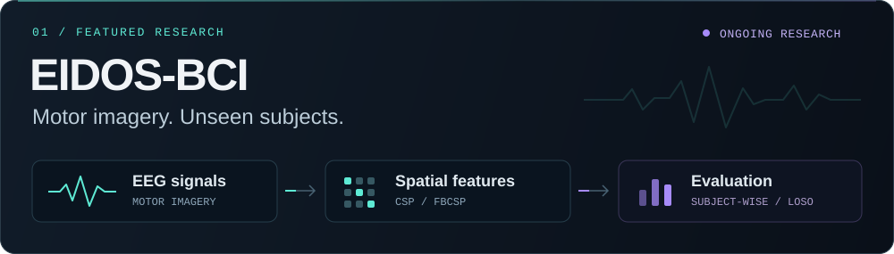
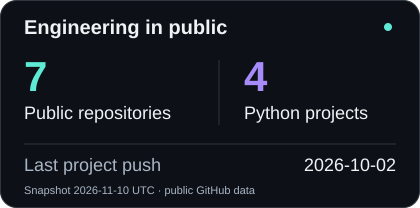
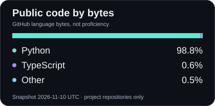

<picture>
  <source media="(max-width: 600px)" srcset="assets/header-mobile.svg">
  
</picture>

  

  
  
  

  <a href="#about-me">About</a> · <a href="#technology-stack">Toolkit</a> · <a href="#featured-projects">Projects</a> · <a href="#research-and-development">Research</a> · <a href="#connect-with-me">Connect</a>

I build across **software, hardware and signals**: from machines that move to models that learn. My current research asks how motor-imagery brain-computer interfaces can work for people they have never been trained on.

## About me

My engineering journey started with a team of five building a complete FDM 3D printer from scratch. That curiosity now takes me from breadboard computer architecture and embedded control to computer vision and EEG analysis.

I'm studying **Electrical Communications & Computer Engineering at Nahda University**, with expected graduation in **2028** and a **3.52 GPA**. Alongside building and researching, I lead the IEEE Nahda technical team and help other students turn ideas into working projects.

## Technology stack

  

**Programming** · Python, C, C++  
**AI, signals & vision** · MNE-Python, NumPy, SciPy, scikit-learn, Pandas, Matplotlib, OpenCV  
**Hardware & engineering** · Arduino, microcontrollers, electronics, PCB fabrication, CNC, 3D printing, Cisco Packet Tracer  
**Development tools** · Git, GitHub, VS Code, Linux fundamentals

**Currently exploring** · React/Next.js fundamentals, Generative AI and LLMs. Within BCI research, I'm investigating alignment and cross-subject generalization.

## Featured projects

<a href="https://github.com/Shihab-Eldin-Ibrahim/EIDOS-BCI">
  <picture>
    <source media="(max-width: 600px)" srcset="assets/eidos-mobile.svg">
    
  </picture>
</a>

**[EIDOS-BCI](https://github.com/Shihab-Eldin-Ibrahim/EIDOS-BCI)** is my modular EEG research framework: signal processing, CSP/FBCSP features, classification experiments and subject-wise evaluation.  
`Python` `MNE` `NumPy` `SciPy` `scikit-learn`  
**Status:** baseline experiments documented; cross-subject generalization work ongoing.

### FDM 3D printer · built from scratch

A working printer designed and assembled with a **team of five**: frame, linear motion, electronics, firmware setup and calibration. My introduction to making mechanical, electrical and software systems work together.  
`Electronics` `Motion control` `Firmware configuration` `3D printing`  
**Status:** completed team build, October 2022–May 2023.

### [AI Face Attendance System](https://github.com/Shihab-Eldin-Ibrahim/Ai-Face-Attendance-System)

A webcam attendance prototype with face registration, Haar-cascade detection, LBPH recognition and automatic Excel logging with duplicate-entry prevention.  
`Python` `OpenCV` `NumPy` `openpyxl`  
**Status:** public prototype.

### [Heart Disease Analysis](https://github.com/Shihab-Eldin-Ibrahim/heart-disease-analysis)

An educational ML project exploring data preparation, feature selection, model tuning and comparison through visualizations and a Streamlit interface.  
`Python` `scikit-learn` `Pandas` `Streamlit`  
**Status:** public educational implementation.

<strong>More hardware, algorithms and networks</strong>

- **8-bit breadboard computer** — discrete logic, ALU, registers, memory, bus and a basic instruction set. Completed May 2026. `Digital logic` `Computer architecture`
- **CNC PCB milling machine** — three-axis motion control, G-code, calibration and prototype PCB fabrication; team of three. Completed December 2025. `Embedded control` `CAD/CAM` `PCB`
- **[Rat in a Maze](https://github.com/Shihab-Eldin-Ibrahim/Rat-in-maze-)** — BFS/DFS search, path visualization and manual solving. Public implementation. `Python` `NumPy` `Pandas`
- **[VLAN & Trunking Lab](https://github.com/Shihab-Eldin-Ibrahim/Trunk-Mode-cisco-packet-tracer-project)** — network segmentation and switch-to-switch trunk links. Published simulation. `Cisco Packet Tracer` `VLANs`

The hardware builds are documented in my CV and portfolio; public code repositories are not yet available.

## Research and development

**EIDOS-BCI · Can an EEG model generalize to an unseen person?**

My completed baseline study compares **CSP and FBCSP** with **LDA, SVM and logistic regression** on the four-class BCI Competition IV 2a dataset.

- **Nine subjects:** compare within-subject validation with leave-one-subject-out evaluation—train on eight people, test on the ninth.
- **Consistent experiments:** a 1–4 second motor-imagery window, training-fold spatial-feature fitting, per-subject confusion matrices and paired statistical comparisons.
- **Finding:** adding filter-bank features did not significantly improve unseen-subject performance in this setup. Understanding that limitation guides the next experiments.

<strong>Baseline results and the next research questions</strong>

The [committed August 2026 baseline](https://github.com/Shihab-Eldin-Ibrahim/EIDOS-BCI/blob/73dab4c857631f460027a124a45df47b03e2fab3/results/four_class/cross_subject/loso_comparison.csv) averages **36.48% CSP** and **36.32% FBCSP** LOSO accuracy across three classifiers. These historical results cover one dataset and the tested configuration.

October code changes introduce **Euclidean alignment**; newer results have not yet been committed. Transfer learning, domain adaptation, Riemannian methods and real-time BCI remain research directions.

[Explore the research repository](https://github.com/Shihab-Eldin-Ibrahim/EIDOS-BCI) · [Read my research notes on LinkedIn](https://www.linkedin.com/posts/shehab-el-din-ibrahim-8b0864212_research-paper-activity-7497677282279383040-jtuA)

**Wider interests:** brain-computer interfaces, AI, signal processing, embedded systems, computer architecture and hardware–software integration.

## Experience and leadership

**Head of Technical Department · IEEE Nahda Student Branch**  
November 2025–present · Member since October 2023  
Led a team of **10**, coordinated **20 technical activities**, and organized **nine workshops, seminars and engineering events**.

**Engineering Trainee · Universiti Malaysia Perlis, Malaysia**  
November 2025  
Hands-on telecommunications and automation training: microcontrollers, sensors, hardware diagnostics, communication protocols and PLC fundamentals.

**Ethical AI & Sustainability Trainee · CIB Egypt**  
Summer 2025  
Explored responsible AI and collaborated on ideas connecting financial innovation with sustainability through *The Green Leap* program.

## Achievements and certifications

- **IEEE Egyptian Student Paper Contest 2026:** presented my EIDOS-BCI research.
- **InnovEgypt 2026:** completed the TIEC/ITIDA innovation program.
- **IEEE EMBS E-JUST Annual Meeting:** [participated in the biomedical engineering event](https://www.linkedin.com/posts/shehab-el-din-ibrahim-8b0864212_certificate-activity-7501276665881493506-FdG5).
- **English:** EF SET **64/100 · C1 Advanced**.

<strong>Selected courses and certificates</strong>

| Course | Provider · completed |
| --- | --- |
| Introduction to Software Engineering | IBM · July 2026 |
| Introduction to Structured Query Language (SQL) | University of Michigan · December 2025 |
| Introduction to AI & Machine Learning | Sprints · September 2025 |
| Introduction to Generative AI | Microsoft · September 2025 |
| Introduction to Cybersecurity | Cisco · August 2025 |
| Programming with Python | Sprints · August 2025 |
| Responsible Innovation and Trustworthy AI | SAS · July 2025 |
| Introduction to Programming Using C++ | Sololearn · April 2025 |
| C Programming | IEEE Nahda · November 2023 |

## GitHub statistics

  
  

  

Repository cards show a dated snapshot; language shares reflect public code bytes, not proficiency. [View my contribution history on GitHub](https://github.com/Shihab-Eldin-Ibrahim).

## Connect with me

I'm interested in collaborating on **BCI research, AI applications and embedded engineering**—especially projects that bring these fields together.

**[LinkedIn](https://www.linkedin.com/in/shehab-el-din-ibrahim-8b0864212)** · **[Email](mailto:shedar326@gmail.com)** · **[GitHub](https://github.com/Shihab-Eldin-Ibrahim)**

<picture>
  <source media="(max-width: 600px)" srcset="assets/footer-mobile.svg">
  
</picture>
